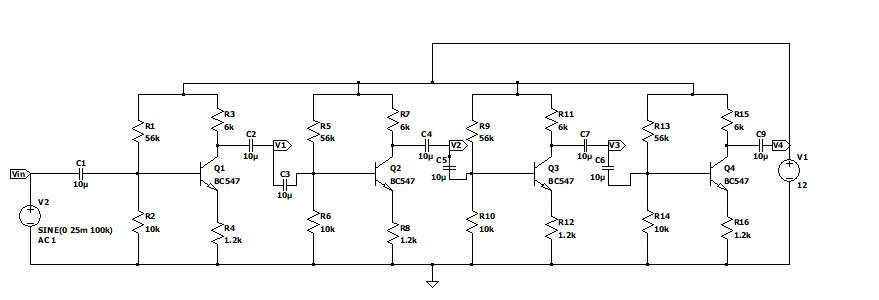
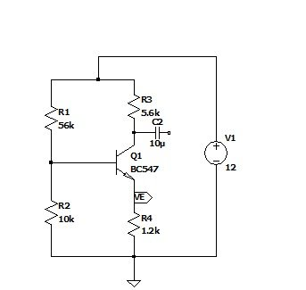
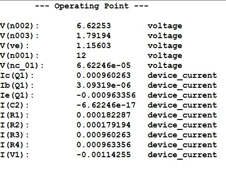
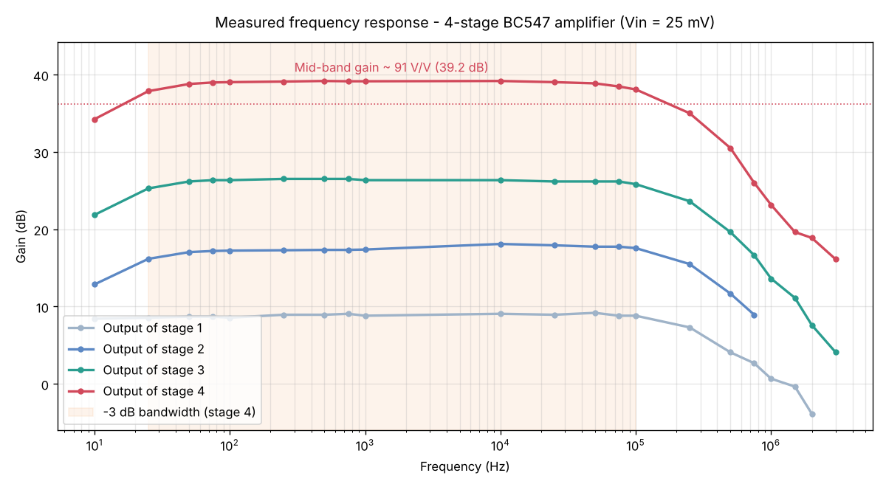
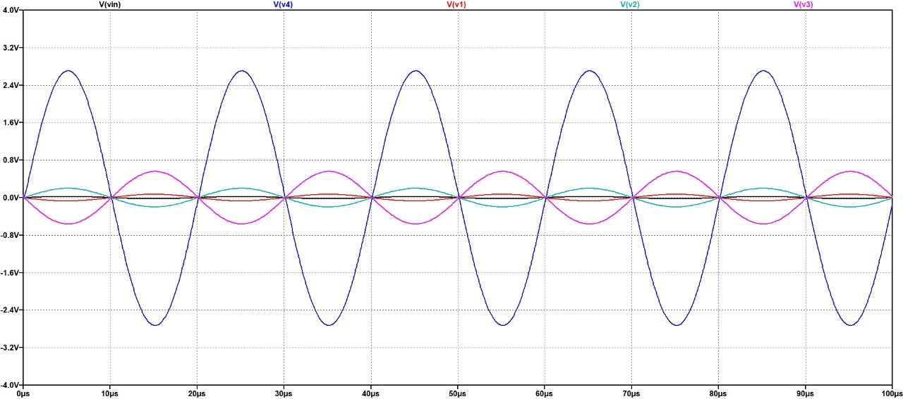
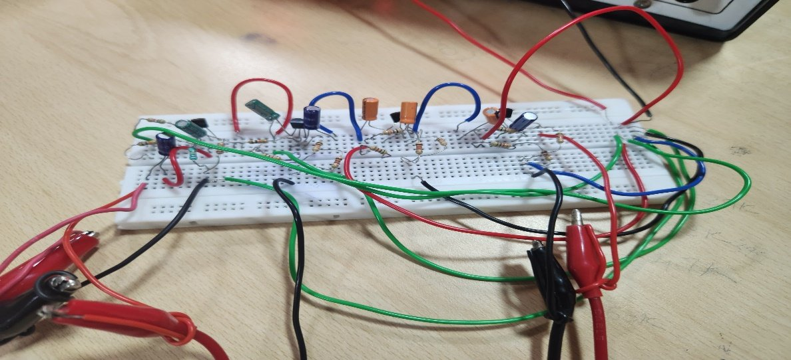
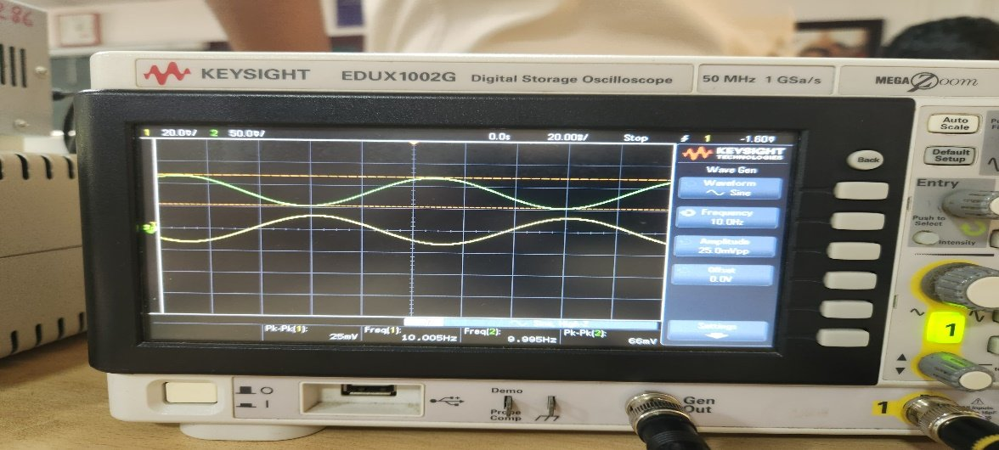
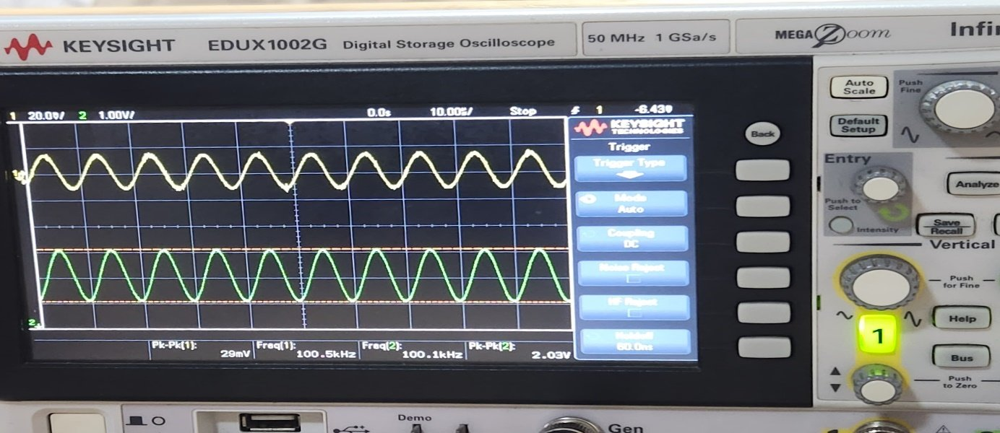

<h1 align="center">4-Stage Cascaded BJT Signal Amplifier</h1>

<p align="center">
  A four-stage common-emitter amplifier built with BC547 transistors. It turns a 25 mV signal into about 2.3 V (≈ 91 V/V, 39 dB) with a flat mid-band. Simulated in LTspice and checked on hardware.
</p>

<p align="center">
  
  
  
  
  
</p>

<p align="center">
  
</p>

---

## Overview

A single transistor stage gives limited gain. This project **cascades four common-emitter (CE) stages**, joined by coupling capacitors, so that each stage amplifies the output of the one before it. The design was built up step by step: bias one stage and check its operating point, then add stages one at a time while measuring gain and bandwidth at each step.

## Design

| Parameter | Value |
|---|---|
| Transistor | BC547 (NPN), common-emitter |
| Supply | V<sub>CC</sub> = 12 V |
| Bias network | Voltage divider R1 = 56 kΩ, R2 = 10 kΩ |
| Collector resistor | R<sub>C</sub> = 6 kΩ |
| Emitter resistor | R<sub>E</sub> = 1.2 kΩ (stabilises the operating point) |
| Coupling capacitors | 10 µF (block DC between stages) |
| Test input | 25 mV sine |

**Q-point (simulated):** I<sub>C</sub> ≈ 0.96 mA, V<sub>C</sub> ≈ 6.6 V, V<sub>B</sub> ≈ 1.8 V, V<sub>E</sub> ≈ 1.16 V. This places the transistor in the middle of the active region, so it can swing the most without clipping.

| Single-stage bias circuit | DC operating point |
|:---:|:---:|
|  |  |

## Results

### Gain per stage (cumulative)

| Stage | Simulated A<sub>v</sub> (V/V) | Measured A<sub>v</sub> (V/V) | Simulated (dB) | Measured (dB) |
|:---:|:---:|:---:|:---:|:---:|
| 1 | 2.8 | 2.64 | 8.94 | 8.43 |
| 2 | 8 | 7.36 | 18.06 | 17.33 |
| 3 | 22 | 20.43 | 26.84 | 26.20 |
| 4 | 62 | 63.85 | 35.84 | 36.10 |

Measured hardware results agree closely with simulation. At mid-band (≈ 500 Hz – 10 kHz) the full amplifier reaches **≈ 91 V/V (39.2 dB)**.

### Measured frequency response

<p align="center">
  
</p>

The response stays within 3 dB of mid-band from **25 Hz to 100 kHz** (measured points). Gain falls at low frequency because of the coupling capacitors, and at high frequency because of transistor junction capacitance. The raw measurements are in [`data/measured_frequency_response.csv`](data/measured_frequency_response.csv).

### Waveforms

| Simulation: all stages | Hardware: breadboard |
|:---:|:---:|
|  |  |
| **Oscilloscope: stage 1 output** | **Oscilloscope: stage 4 output** |
|  |  |

## Run It

- **Simulation:** open [`simulation/four_stage_amplifier.asc`](simulation/four_stage_amplifier.asc) in [LTspice](https://www.analog.com/en/resources/design-tools-and-calculators/ltspice-simulator.html) and press *Run*. Probe nodes `V1`–`V4` to see each stage's output.
- **Frequency response plot:**
  ```bash
  pip install pandas matplotlib numpy
  python plot_frequency_response.py
  ```

## Repository Structure

```
four-stage-bjt-amplifier/
├── simulation/
│   └── four_stage_amplifier.asc        # LTspice schematic (with BC547 model)
├── data/
│   └── measured_frequency_response.csv # Bench measurements, 10 Hz – 3 MHz
├── plot_frequency_response.py
└── docs/
    └── images/
```

## Key Learnings

- DC biasing and Q-point placement for linear, distortion-free amplification
- How cascaded gain builds up stage by stage, and how stages load each other
- How coupling capacitors and device capacitance limit bandwidth
- Checking hardware results against SPICE simulation

## Author

**Sujith Krishna P G**

<a href="https://github.com/SujithPG-coder"></a>
<a href="https://www.linkedin.com/in/sujithkrishnapg/"></a>

## License

This project is licensed under the [MIT License](LICENSE).
